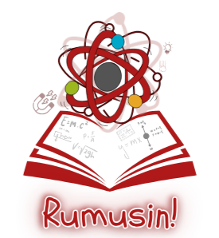

<p align="center">
  
</p>

<h1 align="center">Rumusin Fisika</h1>

<p align="center">
  <strong>"Rumusin Soalnya, Paham Fisikanya!"</strong>
</p>

<p align="center">
  Platform belajar fisika SMA (versi <em>prototype</em> v0.2) yang menggabungkan materi tertulis dengan <strong>Lembar Rumus</strong> bergaya kertas milimeter, tahapan video terstruktur, simulasi kanvas dan kalkulator rumus interaktif, <em>try out</em> bernilai di server dengan mode fokus, <em>leaderboard</em> periodik, forum diskusi per materi, serta <strong>Ruka</strong> — asisten belajar AI kontekstual.
</p>

<p align="center">
  Dikembangkan oleh <strong>Ilyasa Ramadhany</strong> (<a href="https://ilyasaramadhany.my.id">ilyasaramadhany.my.id</a>)
</p>

---

## Status Proyek: Prototype (v0.2)

Repositori ini merupakan **prototype fungsional v0.2** dari Rumusin Fisika yang mencakup:

- **Materi Lengkap & Lembar Rumus**: Enam kategori dan enam materi fisika SMA (*Gerak Lurus GLB & GLBB*, *Hukum Ohm & Rangkaian Listrik*, *Hukum Newton tentang Gerak*, *Usaha & Energi*, *Hukum Archimedes*, *Komponen Elektronika Dasar*) dalam format Markdown + rumus LaTeX (KaTeX) yang disanitasi di server, lengkap dengan ilustrasi SVG di `public/images/materi/`.
- **Tahapan Video**: Daftar video YouTube bertahap (*step track*, 18 tahapan video lintas 6 materi) yang dimuat secara *lazy* lewat `youtube-nocookie.com`.
- **Simulasi Kanvas & Kalkulator Rumus**: Enam simulasi kanvas interaktif dan 15 kalkulator fisika (*Gerak Lurus GLB/GLBB*, *Listrik, Rangkaian & Tagihan Rumahan + Diagram Lingkaran kWh*, *Gaya Newton & Resultan*, *Usaha Mendorong & Jatuh Bebas $E_p \to E_k$*, *Kapal Selam Hukum Archimedes*, *Sirkuit LED & Resistor Elektronika Dasar*) serta kalkulator mini langsung di Lembar Rumus halaman depan.
- **Try Out, Mode Fokus, & Penilaian Server**: Tujuh paket *try out* aktif (6 paket per materi + 1 *Try Out Gabungan Fisika SMA* berisi 20 soal campuran) dengan urutan soal diacak secara deterministik per percobaan, batas percobaan harian (`TRYOUT_DAILY_ATTEMPTS`), mode fokus pengerjaan dengan *action bar* bawah (peta soal, sisa waktu, tombol kirim), penilaian 100% di server (kunci jawaban dan pembahasan tidak pernah dikirim ke browser saat pengerjaan), dan halaman peninjauan hasil.
- **Navigasi Bottom Bar Tunggal**: Seluruh navigasi aplikasi (tamu, pelajar masuk, dan admin beserta panel *"Lainnya"*) berada di satu *bottom bar* melayang yang ramah jempol di ponsel maupun desktop, dilengkapi kepala halaman (`x-pagehead`) ringan di bagian atas.
- **Leaderboard**: Peringkat mingguan (Senin–Minggu WIB), bulanan, dan semua waktu berdasarkan satu percobaan terbaik tiap pelajar (skor tertinggi → durasi tercepat → selesai paling awal).
- **Diskusi per Materi**: Thread tanya jawab teks polos dengan balasan satu tingkat dan moderasi admin.
- **Ruka (Asisten AI per Materi)**: Panel tanya jawab kontekstual di atas *bottom bar* yang memahami isi dan Lembar Rumus materi yang sedang dibuka, menggunakan provider `fake` (untuk pengembangan/pengujian lokal) atau **Google AI Studio (Gemini)** di server.
- **Panel Admin (`/admin`)**: Kelola kategori, materi, video bertahap, bank soal dengan pratinjau KaTeX, paket *try out*, moderasi diskusi, dan daftar pengguna terdaftar.

---

## Tumpukan Teknologi

- **Backend**: PHP 8.3+, Laravel 13
- **Database**: SQLite (default pengembangan lokal; skema dan *query* portabel ke PostgreSQL)
- **Frontend**: Blade (Server-Side Rendered), Bootstrap 5.3 (SCSS modular dengan *design system* Neumorphism + Claymorphism kustom), Vanilla JS, HTML5 Canvas, Vite
- **Tipografi & Rumus**: *Bricolage Grotesque*, *Atkinson Hyperlegible*, KaTeX, `league/commonmark`

---

## Cara Install dari Nol (Lokal)

### 1. Prasyarat
Pastikan perangkat sudah terpasang:
- **PHP >= 8.2** (beserta ekstensi `pdo_sqlite`, `mbstring`, `openssl`, `curl`)
- **Composer 2.x**
- **Node.js >= 20** dan **npm**

### 2. Kloning & Pasang Dependensi

```bash
git clone https://github.com/yasaramdh07/Rumusin-Fisika.git
cd Rumusin-Fisika
composer install
npm install
```

### 3. Salin File `.env` & Siapkan Database SQLite

```bash
cp .env.example .env
php artisan key:generate
```

Buat file database SQLite kosong bila belum ada:

- **macOS / Linux / Git Bash**:
  ```bash
  touch database/database.sqlite
  ```
- **Windows PowerShell**:
  ```powershell
  New-Item -ItemType File -Path database/database.sqlite -Force
  ```

### 4. Cara Seed (Akun Dummy lewat `SEED_PASSWORD` & Seeder Konten)

Seeder Rumusin bersifat **idempotent** (aman dijalankan berulang kali tanpa menggandakan data) dan terbagi menjadi dua kelompok:

1. **Seeder Konten (`database/seeders/content/`)**:
   - `CategorySeeder`: 6 kategori fisika SMA.
   - `LessonSeeder`: 6 materi lengkap dari berkas Markdown ber-*front-matter* (`database/seeders/content/lessons/*.md`) beserta Lembar Rumus dan 18 tahapan video YouTube.
   - `QuestionSeeder`: 37 soal fisika pilihan ganda A–D beserta pembahasan dari `database/seeders/content/questions.json`.
   - `TryoutSeeder`: 7 paket *try out* aktif (6 paket per materi + 1 paket *Try Out Gabungan Fisika SMA* 20 soal).
2. **Seeder Akun & Percobaan Dummy (khusus `APP_ENV=local`)**:
   - `AdminUserSeeder` & `DummyUsersSeeder`: membuat 1 akun admin dan 5 akun pelajar dummy menggunakan password dari variabel environment `SEED_PASSWORD`.
   - `AttemptSeeder`: membuat riwayat percobaan *try out* contoh untuk mengisi *leaderboard* lokal.

Buka file `.env`, lalu isi variabel `SEED_PASSWORD` dengan password lokal pilihan Anda (minimal 8 karakter; nilai ini **wajib** diisi sebelum menjalankan seeder akun di `local` dan tidak pernah disimpan di kode atau repo):

```dotenv
SEED_PASSWORD=isi_password_lokal_anda_di_sini
```

Jalankan migrasi dan seluruh seeder untuk instalasi baru:

```bash
php artisan migrate --seed
```

> **Tips pembaruan konten**: Karena seluruh seeder konten bersifat idempotent, jika database lokal Anda sudah memiliki data pengguna dan Anda hanya ingin menyinkronkan ulang materi/soal/paket *try out* tanpa menghapus pengguna, jalankan:
> ```bash
> php artisan db:seed
> ```

Setelah seeder selesai di environment `local`, Anda bisa masuk (`/masuk`) memakai password dari `SEED_PASSWORD` di `.env` Anda dengan salah satu akun dummy berikut:

| Peran | Username | Email |
| :--- | :--- | :--- |
| **Admin** | `admin_rumusin` | `admin@rumusin.test` |
| **Pelajar 1** | `usersaturumusin` | `usersatu@rumusin.test` |
| **Pelajar 2** | `userduarumusin` | `userdua@rumusin.test` |
| **Pelajar 3** | `usertigarumusin` | `usertiga@rumusin.test` |
| **Pelajar 4** | `userempatrumusin` | `userempat@rumusin.test` |
| **Pelajar 5** | `userlimarumusin` | `userlima@rumusin.test` |

### 5. (Opsional) Konfigurasi Asisten AI Ruka

Secara bawaan `.env.example` memakai `AI_PROVIDER=fake` sehingga fitur chat Ruka langsung dapat dicoba secara lokal tanpa koneksi API eksternal.

Untuk mengaktifkan **Google AI Studio (Gemini)**, ubah variabel berikut di `.env`:

```dotenv
AI_PROVIDER=google
AI_API_KEY=isi_api_key_google_ai_studio_anda
AI_MODEL=gemini-2.5-flash
RUKA_DAILY_LIMIT=20
```

> **Catatan keamanan**: `AI_API_KEY` hanya dibaca di server melalui `config('rumusin.ai.api_key')` dan tidak pernah dikirim ke browser ataupun dicatat ke log.

### 6. Bangun Aset & Jalankan Server

Untuk pengembangan harian (dua terminal):

```bash
php artisan serve
npm run dev
```

Atau bangun aset produksi terlebih dahulu:

```bash
npm run build
php artisan serve
```

Buka `http://127.0.0.1:8000` di browser.  
Pada mode `APP_ENV=local`, halaman pemeriksaan komponen desain (termasuk pratinjau 3 konteks *bottom bar*, panel *"Lainnya"*, *action bar* mode fokus *try out*, dan kepala halaman) tersedia di `http://127.0.0.1:8000/styleguide`.

---

## Menjalankan Pengujian Otomatis

Seluruh pengujian (*unit* & *feature test*) menggunakan SQLite *in-memory* dan `FakeRukaProvider` sehingga tidak menyentuh database lokal maupun kuota API eksternal:

```bash
php artisan test
```

---

## Struktur Proyek

```text
├── app/
│   ├── Http/
│   │   ├── Controllers/        # Controller publik, pelajar, dan Admin/
│   │   └── Middleware/         # EnsureUserIsAdmin (proteksi rute /admin/*)
│   ├── Models/                 # User, Category, Lesson, LessonVideo, Question, Tryout,
│   │                           # TryoutAttempt, TryoutAnswer, Thread, Reply, RukaMessage
│   ├── Services/
│   │   ├── Ruka/               # RukaProvider (interface), FakeRukaProvider, GoogleAiStudioRukaProvider
│   │   ├── LeaderboardService.php
│   │   ├── LessonRenderer.php  # Markdown + proteksi delimiter KaTeX + sanitasi HTML
│   │   ├── RukaService.php     # System prompt, konteks materi, batas harian
│   │   └── TryoutAttemptService.php
│   └── Support/
│       └── YoutubeUrlParser.php
├── config/
│   └── rumusin.php             # Konfigurasi kuota try out, Ruka, dan AI provider
├── database/
│   ├── factories/              # Factory model untuk pengujian
│   ├── migrations/             # Skema portabel SQLite & PostgreSQL
│   └── seeders/                # AdminUserSeeder, DummyUsersSeeder, CategorySeeder,
│       ├── content/            # Sumber konten idempotent (categories.json, questions.json, lessons/*.md)
│       └── ...                 # LessonSeeder, QuestionSeeder, TryoutSeeder, AttemptSeeder
├── public/
│   └── images/
│       ├── logo-rumusin.png    # Logo utama Rumusin Fisika
│       └── materi/             # Ilustrasi SVG materi fisika
├── resources/
│   ├── js/
│   │   ├── tools/              # Modul simulasi kanvas & kalkulator per topik fisika (6 berkas)
│   │   ├── bottombar.js        # Panel "Lainnya" admin (focus trap, Escape, klik luar, aria-expanded)
│   │   └── app.js              # KaTeX auto-render, video switcher, timer try out, Ruka chat
│   ├── scss/
│   │   ├── abstracts/          # Token warna (--rf-*), z-index, tipografi, mixin elevasi clay/neumorphic
│   │   ├── base/               # Reset, tipografi, focus ring (:focus-visible)
│   │   ├── components/         # Bottom bar, pagehead, actionbar, tombol, slab, formula-sheet, chat, dll.
│   │   └── pages/              # Gaya spesifik halaman (landing, lesson, tryout, admin, dll.)
│   └── views/
│       ├── components/         # Komponen Blade (x-bottombar, x-pagehead, x-actionbar, x-icon, dll.)
│       └── ...                 # Template halaman (layouts, welcome, home, lessons, tryouts,
│                               # leaderboard, profile, auth, admin, styleguide)
├── routes/
│   └── web.php                 # Definisi rute publik, auth, dan admin
└── tests/
    ├── Feature/                # Pengujian fitur end-to-end (Auth, Lesson, Admin, Tryout,
    │                           # Leaderboard, Discussion, Ruka, ContentImportSeeder,
    │                           # BottomBarNavigation, QaAudit)
    └── Unit/                   # Pengujian unit (YoutubeUrlParser, PhysicsCalculator 45 kasus uji)
```
